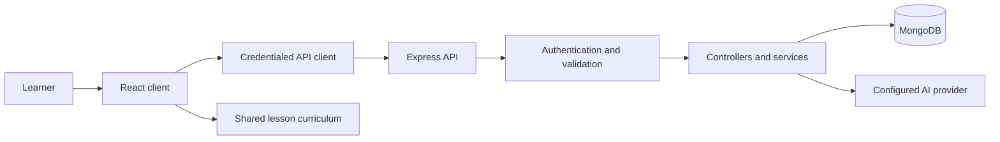

# ErneAI

ErneAI is a Kannada-learning project with a React/Vite client and an Express/MongoDB API. It keeps the existing public website and protected learning portal; accounts, favorites, scenario activity, lesson attempts, and user-owned supplementary lesson content are stored by the backend.

## Official hackathon problem statement

### REAL-WORLD APPLICATION

### Kannada in Everyday Life

Develop a technology solution that helps people learn and use Kannada in real-world situations such as travelling, shopping, education, healthcare, transportation, and workplaces.

## Hackathon entry status

ErneAI addresses this challenge with practical Kannada phrases, structured lessons, and guided practice for everyday situations.

| Submission item | Current status |
|---|---|
| Official problem statement | Included above using the supplied wording. |
| Project overview and architecture | Documented below. |
| Slide deck and demo video | Not present in the workspace. |
| Public demo URL and deployment configuration | Not present or verified; see [Deployment status](#deployment-status). |
| Demo account | No shared demo credentials are documented. Create an account with placeholder details using the local signup flow. |
| License and content/asset acknowledgements | No project-level license or complete source/asset attribution is present; see [Credits and licensing](#credits-and-licensing). |

## Project map and request flow

The client owns presentation and browser navigation. The API owns validation, authentication, and persistent learning data. MongoDB stores accounts, phrases, favorites, and progress.

```text
client/
  public/                 Static files served as-is
  src/
    App.jsx               Route tree and provider composition
    components/           Shared visual pieces used by pages
    context/              Authentication and theme state
    data/                 Static scenario metadata and example phrases
    hooks/                Reusable favorites, progress, auth, and theme state
    layouts/              Public-site and signed-in portal shells
    pages/                Public, account, learning, and practice screens
    routes/               Protected-route session gate
    services/             API transport, endpoint wrappers, auth, practice
    assets/               Scenario illustrations and other bundled assets
    index.css             Global styles and responsive layouts
  index.html              Vite HTML entry point
  vite.config.js          Vite and React plugin configuration
  package.json            Client scripts and dependencies

shared/
  lessonContent.js        Structured beginner curriculum content
  curricula.js            Beginner, intermediate, and advanced lesson paths

server/
  src/
    app.js                Express middleware, route mounting, and error handling
    server.js             Environment validation, database startup, and listener
    config/               Mongo connection, session settings, scenarios, DNS helper
    controllers/           Request validation and endpoint business operations
    data/                 Seed phrase records
    middleware/           Origin/auth/ID guards and shared error utilities
    models/               Mongoose schemas for users, phrases, favorites, progress
    routes/               HTTP endpoint definitions and route-level guards
    scripts/              Database seed and favorite-index migration commands
    services/             AI generation, favorite-index migration, and practice helpers
  tests/                  API, authentication, and session behavior tests
  package.json            Server scripts and dependencies
```

### Main module responsibilities

- **Client routing and state:** `client/src/main.jsx` mounts React. `client/src/App.jsx` defines public and protected routes and composes the theme and auth providers. `client/src/context/AuthContext.jsx` restores the server session and exposes sign-in, sign-up, and sign-out actions; `ThemeContext.jsx` manages the selected theme. `ProtectedRoute.jsx` prevents portal access until authentication has been checked.
- **Client interface and learning data:** `client/src/pages/` contains the route-level screens. `client/src/components/` contains reusable interface elements, including navigation, scenario/phrase cards, the hero, and conversation previews. `shared/curricula.js` combines the structured Beginner, Intermediate, and Advanced lesson paths; `client/src/components/SupplementaryLesson.jsx` presents optional generated practice. `client/src/data/scenarios.js` is the client’s static scenario metadata. `client/src/hooks/useFavorites.js` and `useLearningProgress.js` load and update account-owned data for the portal.
- **Client API and browser services:** `client/src/services/apiClient.js` is the shared HTTP transport; it sends browser credentials for HTTP-only session cookies and normalizes API errors. `api.js` wraps learning endpoints, while `authService.js` wraps session endpoints. `conversation.js` provides the client-side practice conversation helpers.
- **Server startup and configuration:** `server/src/server.js` validates configuration, connects to MongoDB, and only then starts listening. `config/db.js` owns the Mongoose connection and readable connection errors; `config/session.js` parses the cookie/JWT lifetime; `config/scenarios.js` is the supported scenario list used by server logic and schemas. `config/dns.js` applies the existing Windows DNS workaround.
- **Server HTTP and persistence:** `server/src/app.js` configures common Express middleware, mounts routers, and sends unmatched requests through the shared error handler. Files in `routes/` map URLs to middleware/controllers. Files in `controllers/` validate endpoint inputs and coordinate model operations; `services/aiService.js` handles mock or configured provider responses. `middleware/requireAuth.js` verifies the session cookie and user token version; other middleware checks request origin and object IDs. `middleware/errorHandler.js` converts expected HTTP errors to JSON and logs unexpected server errors without returning internal details.
- **Database modules:** `models/User.js` stores account, password-hash, learning-level, and token-version fields while omitting sensitive fields from JSON. `Phrase.js` stores indexed scenario phrase content; `Favorite.js` stores each user's phrase and lesson saves with per-item uniqueness; `Progress.js` stores each user's visited scenarios. `scripts/seed.js` upserts the sample records from `data/seedPhrases.js`.

#### Client module reference

| Module | Responsibility |
|---|---|
| `client/src/pages/` | Route screens: public information, login/signup, dashboard, scenario learning, practice, favorites, and profile. |
| `client/src/components/` | Reusable UI: page hero, navigation/footer/branding, scenario and phrase cards, favorite controls, feature cards, chat/conversation previews, auth phrase panel, sidebar, theme control, and scroll reveal. |
| `client/src/layouts/` | Shared page shells for the public site and the signed-in portal. |
| `client/src/context/` | Shared authentication and theme providers, with context objects kept separate from provider components. |
| `client/src/hooks/` | Reusable authentication, theme, favorites, and learning-progress state. |
| `client/src/services/apiClient.js` | Credentialed fetch, JSON parsing, and consistent API errors. |
| `client/src/services/api.js` and `authService.js` | Learning-data and authentication endpoint wrappers. |
| `client/src/services/conversation.js` and `practicePhrase.js` | Local conversation and practice phrase helpers. |
| `client/src/data/scenarios.js` | Static client scenario metadata and example phrases used in the interface. |

#### Server module reference

| Module | Responsibility |
|---|---|
| `server/src/config/db.js` | Connects Mongoose to `MONGO_URI` and translates common connection failures into actionable messages. |
| `server/src/config/dns.js` | Applies the existing DNS workaround on Windows environments that report only a loopback resolver. |
| `server/src/config/scenarios.js` | Defines supported scenario IDs/names for API validation and model schemas. |
| `server/src/config/session.js` | Validates the configured JWT duration and converts it to cookie max-age. |
| `server/src/routes/authRoutes.js` | Signup/login/logout and current-user/profile routes; limits authentication attempts and protects signed-in endpoints. |
| `server/src/routes/scenarioRoutes.js` | Public list of supported scenarios. |
| `server/src/routes/phraseRoutes.js` | Public phrase listing/search and phrase-by-ID routes. |
| `server/src/routes/favoriteRoutes.js` | Authenticated list/add/remove routes with item and favorite-ID validation. |
| `server/src/routes/progressRoutes.js` | Authenticated read/update routes for scenario activity and scored lesson progress. |
| `server/src/routes/lessonRoutes.js` | Authenticated, rate-limited Groq supplementary lesson generation. |
| `server/src/routes/practiceRoutes.js` | Authenticated, rate-limited practice reply route. |
| `server/src/controllers/authController.js` | Validates credentials/profile changes, hashes passwords, issues/clears the session cookie, and revokes sessions on logout. |
| `server/src/controllers/phraseController.js` | Validates phrase filters, queries phrase records, and maps database records to the API response shape. |
| `server/src/controllers/favoriteController.js` | Creates, lists, and removes user-owned favorite records. |
| `server/src/controllers/progressController.js` | Reads scenario activity and saves lesson attempts for the signed-in user. |
| `server/src/controllers/lessonController.js` | Validates requested topics and caches lessons under the authenticated user and saved level. |
| `server/src/controllers/practiceController.js` | Validates the conversation and delegates to the configured practice-reply service. |
| `server/src/middleware/checkOrigin.js` | Rejects untrusted origins for state-changing requests. |
| `server/src/middleware/requireAuth.js` | Verifies the HTTP-only JWT cookie, loads its user, and checks the token version. |
| `server/src/middleware/validateObjectId.js` | Validates MongoDB IDs in route parameters before controller queries. |
| `server/src/middleware/errorHandler.js` | Provides `HttpError`/async-route helpers and the shared JSON error response. |
| `server/src/models/User.js` | Account schema; protects password hash/token version from normal selection and JSON output. |
| `server/src/models/Phrase.js` | Phrase schema with scenario, difficulty, and uniqueness indexes. |
| `server/src/models/Favorite.js` | User-owned phrase and lesson saves with per-type unique constraints. |
| `server/src/models/Progress.js` | User-owned scenario and current lesson progress. |
| `server/src/models/LessonAttempt.js` | Scored, level-tagged lesson attempts and answer history. |
| `server/src/models/SupplementaryLesson.js` | User- and level-scoped cache for generated lesson content. |
| `server/src/services/aiService.js` | Validates configured practice replies, situation phrase generation, and Groq-generated supplementary lessons. |
| `server/src/services/favoriteIndexMigration.js` | Preserves legacy favorites while applying per-item unique indexes. |
| `server/src/data/seedPhrases.js` and `server/src/scripts/seed.js` | Seed records and the repeatable MongoDB upsert command. |

For a normal learning request, a page calls a hook or service, the client API wrapper sends a credentialed request, an Express route applies any authentication/validation middleware, and its controller reads or updates the appropriate Mongoose model. Mongoose communicates with the configured MongoDB database. The API returns JSON under `data`; the client transport extracts that value or raises a readable error. On login/signup, the API sets an HTTP-only cookie rather than returning a token for browser storage; later requests include that cookie, and the auth middleware verifies it against the current user.



## Requirements

- Node.js 20.19 or newer, or 22.12 or newer (Vite's supported Node.js range)
- npm
- MongoDB Community Server running locally, or a MongoDB Atlas connection string

The current lockfiles resolve React 19.3.1, Vite 8.3.5, and React Router 7.18.4 for the client, and Express 5.3.0 and Mongoose 8.24.7 for the server.

## Install

In one terminal:

```powershell
cd D:\ErneAi\server
npm install
if (!(Test-Path .env)) { Copy-Item .env.example .env }
```

In another terminal:

```powershell
cd D:\ErneAi\client
npm install
```

The server and client each provide an `.env.example`. The server setup below copies `server/.env.example` to the ignored `server/.env`; client API configuration is optional and can be copied from `client/.env.example` to `client/.env.local`.

## Configure MongoDB and the server

Edit `server/.env` and set:

```env
PORT=5000
NODE_ENV=development
MONGO_URI=mongodb://127.0.0.1:27017/erne_ai
CLIENT_URL=http://localhost:5173
JWT_SECRET=
JWT_EXPIRES_IN=7d
COOKIE_SAME_SITE=lax
COOKIE_SECURE=false
AI_PROVIDER=mock
AI_API_KEY=
HF_TOKEN=hf_your_inference_providers_token
GROQ_API_KEY=gsk_your_groq_api_key
AI_MODEL=
AI_BASE_URL=
```

For local MongoDB, install and start MongoDB Community Server before starting the API. For Atlas, create a database and set `MONGO_URI` to its connection string; keep the password and URI private, and allow your development machine in Atlas network access settings. Do not commit `server/.env`.

The browser client defaults to `http://localhost:5000`. To use another API address, set `VITE_API_URL` in `client/.env.local`. Set `CLIENT_URL` to the exact browser origin, including protocol and port. Cookie-based requests use credentials; the API only allows that configured origin.

Generate a private session secret with Node.js, then put the output in `JWT_SECRET` in `server/.env`:

```powershell
node -e "console.log(require('node:crypto').randomBytes(32).toString('hex'))"
```

Use the generated value as `JWT_SECRET`. `JWT_EXPIRES_IN` accepts a positive duration such as `30m`, `12h`, or `7d`, and controls both the signed token and cookie expiry. In production, use HTTPS and configure `COOKIE_SECURE=true`. If the client and API are deployed on different sites, configure `COOKIE_SAME_SITE=none`, `COOKIE_SECURE=true`, and retain the origin check. This MVP has not had a production security audit.

## Seed Kannada phrases

With MongoDB running and `server/.env` configured:

```powershell
cd D:\ErneAi\server
npm run seed
```

The seed command can be run repeatedly; it updates the same scenario/phrase entries rather than creating duplicate phrases. The starter phrases are practical examples, not certified translations; have a fluent Kannada speaker review them before relying on them in a high-stakes setting. Healthcare phrases only help users communicate with a clinician and are not medical advice.

## Start the application

Start the backend in one terminal:

```powershell
cd D:\ErneAi\server
npm run dev
```

Start the frontend in a second terminal:

```powershell
cd D:\ErneAi\client
npm run dev
```

Open the Vite URL (normally `http://localhost:5173`). The server waits for a successful MongoDB connection before listening. `npm start` starts the API without nodemon.

On server startup, Erne AI migrates legacy Favorite indexes without deleting saved items, then ensures the per-item unique indexes for phrases and lessons exist. You can also run `npm run migrate:favorites` from `server/` to apply the same migration manually. After upgrading to situation-based phrase generation, run `npm run migrate:generated-phrases` once from `server/` to replace the old phrase uniqueness indexes without deleting saved data.

## Deployment status

No hosting configuration or public deployment URL is present in this workspace, and a hosted deployment was not verified. For a hosted demo, build the client with `npm run build` in `client/` and serve `client/dist`; run the API from `server/` with `npm start`, a reachable MongoDB database, and private server environment variables. Set `VITE_API_URL` to the hosted API and `CLIENT_URL` to the exact client origin. Production also requires HTTPS and secure cookie settings as described above. Live AI generation requires valid provider credentials and was not verified as part of this readiness audit.

## Try the app

1. Sign up with placeholder name/email details and a password of 8 or more characters (maximum 72 UTF-8 bytes).
2. Verify a duplicate email is rejected; login uses the real password hash stored by MongoDB.
3. Refresh a protected page to verify the HTTP-only session cookie restores the user.
4. Open Learn Kannada to follow the course for the saved profile level. Lesson attempts and completion are stored per level; switching levels preserves past attempt history.
5. Open Explore Phrases to generate phrases for a predefined or custom situation, then save/remove phrases and use Favorites to revisit them.
6. Open Learn Kannada separately for the guided curriculum; open a scenario to search the existing phrase collection.
7. Try practice. With `AI_PROVIDER=mock`, the backend returns curated sample replies with `mode: "mock"`. No live model is called.
8. Log out and verify a protected API request requires login. Logging out invalidates the account's existing JWT cookies by incrementing its server-side token version.

## Optional AI practice

Mock replies are the default and work without an AI account. The existing OpenAI-compatible provider remains available by setting `AI_PROVIDER=openai`, `AI_API_KEY`, and optionally `AI_MODEL` and `AI_BASE_URL` in `server/.env`. The OpenAI defaults are `gpt-4o-mini` and `https://api.openai.com/v1`.

To use Hugging Face Inference Providers, create a Hugging Face fine-grained access token with the **Inference Providers** permission (the `inference.serverless.write` permission), then set these values in `server/.env`:

```env
AI_PROVIDER=huggingface
HF_TOKEN=hf_your_actual_token
AI_MODEL=Qwen/Qwen2.5-7B-Instruct
AI_BASE_URL=https://router.huggingface.co/v1
```

The chat-completions endpoint is `${AI_BASE_URL}/chat/completions`. Hugging Face documents this [OpenAI-compatible chat-completions API](https://huggingface.co/docs/inference-providers/en/tasks/chat-completion), and its [model provider mapping](https://huggingface.co/api/models/Qwen/Qwen2.5-7B-Instruct?expand%5B%5D=inferenceProviderMapping) currently lists `Qwen/Qwen2.5-7B-Instruct` as live through Featherless AI. The API key or Hugging Face token must remain in `server/.env`; never place it in source code, a `VITE_` variable, frontend request, or log. Restart the backend after changing provider settings. The client continues to call `POST /api/practice/respond` and receives the same `kannada`, `transliteration`, `english`, `suggestions`, and `mode` fields.

Groq is also supported through its OpenAI-compatible API. Create an API key in the Groq console, then configure `server/.env`:

```env
AI_PROVIDER=groq
GROQ_API_KEY=gsk_your_actual_key
AI_MODEL=openai/gpt-oss-20b
AI_BASE_URL=https://api.groq.com/openai/v1
```

Groq’s [OpenAI compatibility guide](https://console.groq.com/docs/openai) documents that base URL and `GROQ_API_KEY` authentication. `openai/gpt-oss-20b` is listed in the [Groq model documentation](https://console.groq.com/docs/model/openai/gpt-oss-20b), the [active model/rate-limit documentation](https://console.groq.com/docs/rate-limits), and the [structured outputs supported-model list](https://console.groq.com/docs/structured-outputs). Practice requests use Groq strict JSON Schema mode with this model and validate the generated fields on the server before returning the existing response contract; invalid output is returned as an API error rather than replaced with a fabricated reply. The application reads `AI_MODEL` as configured and does not silently substitute another model. Groq’s public rate-limit docs distinguish plan limits and the exact limits depend on the account; check the Groq console’s Limits page to confirm current availability for your account. Public documentation does not guarantee no-cost access for every account/model, so this configuration should not be treated as confirmation of free-tier eligibility or successful live use.

Keep `GROQ_API_KEY` exclusively in `server/.env`. Never use a `VITE_` variable, send the key from the browser, or commit it. The provider tests use mocked HTTP responses and do not validate live credentials or account quotas.

The Learn Kannada page offers optional topic-based supplementary lessons when `AI_PROVIDER=groq` is configured. Requests use the authenticated user's saved learning level, are limited to five per 15 minutes, and are cached by user, level, and normalized topic. Generated lessons are server-validated and labeled for review; they do not change the baseline curriculum or count as saved course progress. If Groq is unavailable or returns invalid content, the request reports an error and the saved baseline lessons remain usable.

Explore Phrases generates three to five validated Kannada phrase records for a selected predefined situation or custom text. The authenticated user's saved learning level is included, custom situations are limited to 160 characters and treated as untrusted data, and requests are limited to ten per 15 minutes. Generated phrases are saved as ordinary phrase records so the existing Favorite Phrases flow can save and remove them. Generation requires `AI_PROVIDER=groq`, a valid `GROQ_API_KEY`, and a reachable MongoDB; provider, timeout, malformed-output, and database failures are returned as readable errors rather than mock success.

Run the backend tests (provider calls are mocked; this does not require MongoDB or a live AI token):

```powershell
cd D:\ErneAi\server
npm test
```

The client has no npm test script; its existing tests can be run directly:

```powershell
cd D:\ErneAi\client
node --test
```

For a live check, configure MongoDB and a valid signed-in account, start the backend and client, sign in, and send a practice message. Successful live calls return `mode: "ai"`; without an AI provider the mock response returns `mode: "mock"`. AI-generated translations should be independently reviewed before relying on them in high-stakes situations.

## API overview

JSON success responses use `{ "data": ... }`; errors use `{ "error": { "message": "..." } }`.

| Method | Endpoint | Access | Purpose |
|---|---|---|---|
| GET | `/api/health` | Public | API health (server starts only after DB connects) |
| POST | `/api/auth/signup` | Public | Create account and set session cookie |
| POST | `/api/auth/login` | Public | Verify credentials and set session cookie |
| POST | `/api/auth/logout` | Public | Clear and invalidate the session cookie |
| GET | `/api/auth/me` | Signed in | Read safe account profile |
| PATCH | `/api/auth/me` | Signed in | Update preferred learning level |
| GET | `/api/scenarios` | Public | List the five learning scenarios |
| GET | `/api/phrases?scenario=transport&search=bus` | Public | Filter phrases by scenario and search text |
| GET | `/api/phrases/:id` | Public | Read one phrase |
| POST | `/api/phrases/generate` | Signed in | Generate and persist phrases for `{ "scenarioId": "shopping" }`, a situation-scoped request such as `{ "scenarioId": "shopping", "query": "asking for a discount" }`, or `{ "situation": "Ordering food at a restaurant" }` |
| GET | `/api/favorites` | Signed in | List current-user saved phrases and lessons, newest first |
| POST | `/api/favorites` | Signed in | Save `{ "phraseId": "..." }` or `{ "type": "lesson", "lessonId": "..." }`; duplicate saves return the existing favorite |
| DELETE | `/api/favorites/:favoriteId` | Signed in | Remove the current user's favorite by favorite-record ID |
| GET | `/api/progress` | Signed in | Read visited scenarios |
| PUT | `/api/progress` | Signed in | Mark `{ "scenario": "transport" }` visited |
| GET | `/api/progress/lessons` | Signed in | Read active-level completions, vocabulary mastery, and recent attempts |
| PUT | `/api/progress/lessons/current` | Signed in | Save the current unlocked lesson in the active level |
| POST | `/api/progress/lessons/:lessonId/attempts` | Signed in | Validate and persist a scored lesson attempt |
| POST | `/api/lessons/generate` | Signed in | Generate or load a cached supplementary lesson for `{ "topic": "weather" }` |
| POST | `/api/practice/respond` | Signed in | Request scenario practice response |

Protected routes use an HTTP-only cookie and server-side ownership filters. Password hashes and session tokens are not returned to the frontend. The browser does not store the session token in localStorage. Authentication, practice, and lesson-generation requests have basic rate limits; client-origin validation and Helmet headers are enabled.

The Favorites page shows only learning items saved by the signed-in user. It supports phrase/lesson filters, searching Kannada script, transliteration, English meanings, lesson titles, and context, plus sorting by recently saved or English A–Z. Favorite changes are reflected in the shared portal state and persisted by the authenticated API.

## Troubleshooting

- **The API exits before listening:** confirm MongoDB is running and `MONGO_URI` points to a reachable database. The API intentionally connects to MongoDB before opening its port.
- **MongoDB authentication or network errors:** check the username/password in the private `server/.env`, Atlas network-access allowlist, DNS, firewall, hostname, and port. Never paste the private connection string into client configuration.
- **The browser reports a CORS/origin error:** set `CLIENT_URL` to the exact client origin (scheme, hostname, and port), then restart the API. If `VITE_API_URL` is set, ensure it points to the running API.
- **The API rejects its configuration:** set a private `JWT_SECRET` of at least 32 characters, use a supported positive `JWT_EXPIRES_IN` duration, and check `PORT`, `COOKIE_SAME_SITE`, and `COOKIE_SECURE`. `COOKIE_SAME_SITE=none` requires `COOKIE_SECURE=true`.
- **The API exits because an AI credential is missing:** when using a live provider, set `AI_API_KEY` for OpenAI, `HF_TOKEN` for Hugging Face, or `GROQ_API_KEY` for Groq in `server/.env`. Mock mode requires no provider key. Restart the backend after updating the environment; never put a provider key in a `VITE_` variable.
- **Practice cannot contact Groq:** verify the `GROQ_API_KEY`, active `AI_MODEL`, account availability, and configured `AI_BASE_URL` in the private `server/.env`. The default model is `openai/gpt-oss-20b`; strict JSON Schema output is validated server-side. Check the sanitized backend diagnostic for provider status/code without logging failed generations or conversation text.
- **Explore Phrases cannot generate:** verify `AI_PROVIDER=groq`, `GROQ_API_KEY`, MongoDB connectivity, and the authenticated session. Phrase generation does not use the mock provider.

## Validation and limitations

- `client`: `npm run lint`, `npm run build`
- `client`: `node --test` (the current phrase-helper tests)
- `server`: `npm test` (API contract, mocked signup/login/session-cookie lifecycle, auth guards, validation, safe profile serialization, and mock mode)
- `server`: `npm run seed`; the API starts only after database connection.
- There is currently no frontend test script or separate backend lint/format script.
- Personal data is local to the MongoDB deployment. Back it up appropriately.
- This MVP uses one token version per user, so logout invalidates that user's existing sessions.
- AI mode depends on the configured provider, network access, and model availability.
- Phrase content is a small starter set, not a complete or professionally certified language course.

## Possible future work

These are candidate improvements, not completed features or hackathon commitments:

- Confirm the official challenge statement and map the demo narrative to that exact requirement.
- Have fluent Kannada speakers review and expand the phrase and lesson content.
- Add automated browser-level coverage for signup, learning progress, generated phrases, and favorites.
- Complete deployment, monitoring, backup, accessibility, and security reviews before inviting public use.

## Credits and licensing

There is no project-level `LICENSE` file, so the project's reuse and redistribution terms are unspecified. The team should confirm ownership and permission before publishing, choose a license with the appropriate owner/organizer, and document the sources and required credits for bundled images, phrase/translation content, and other non-original assets. Dependency licenses are available from the package metadata and installed dependency notices; they do not establish a license for this project.
